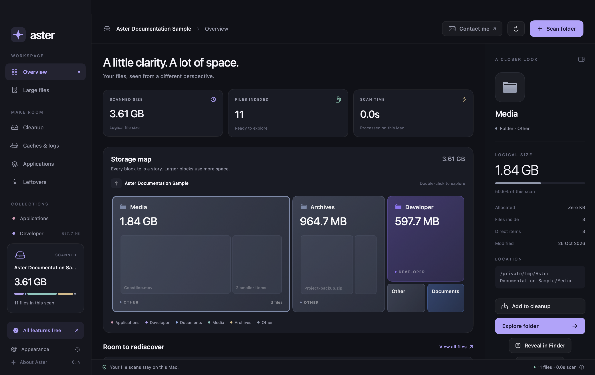
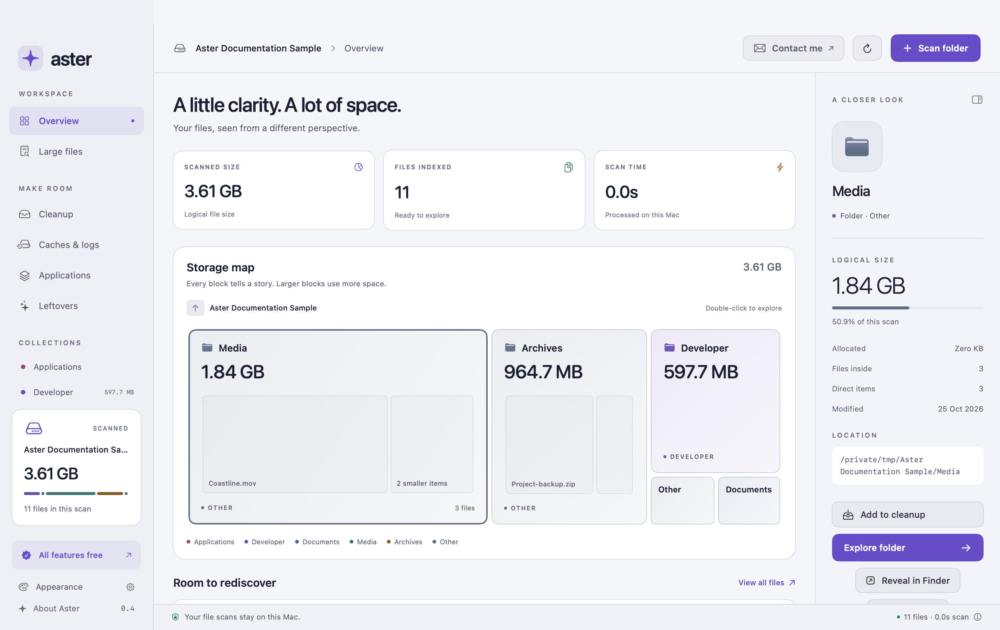
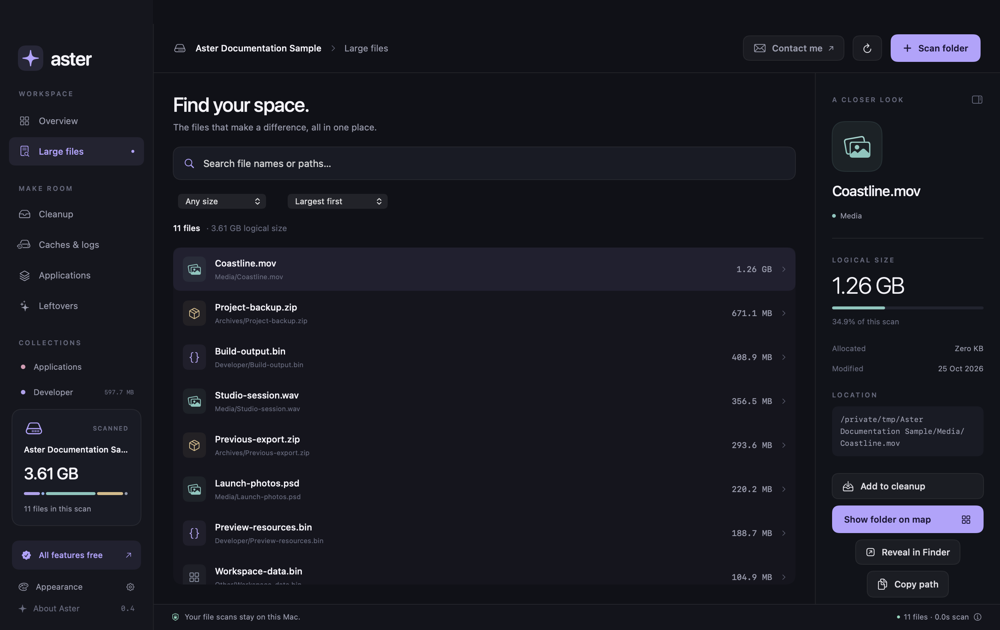
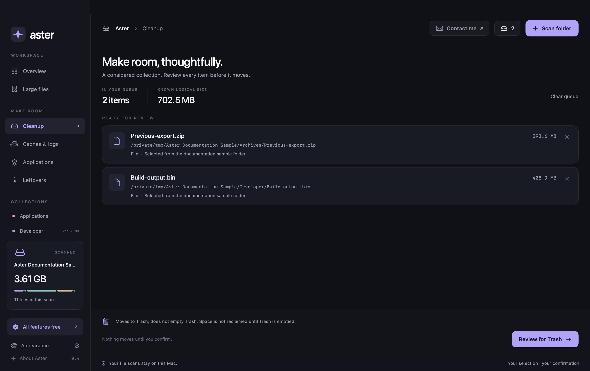
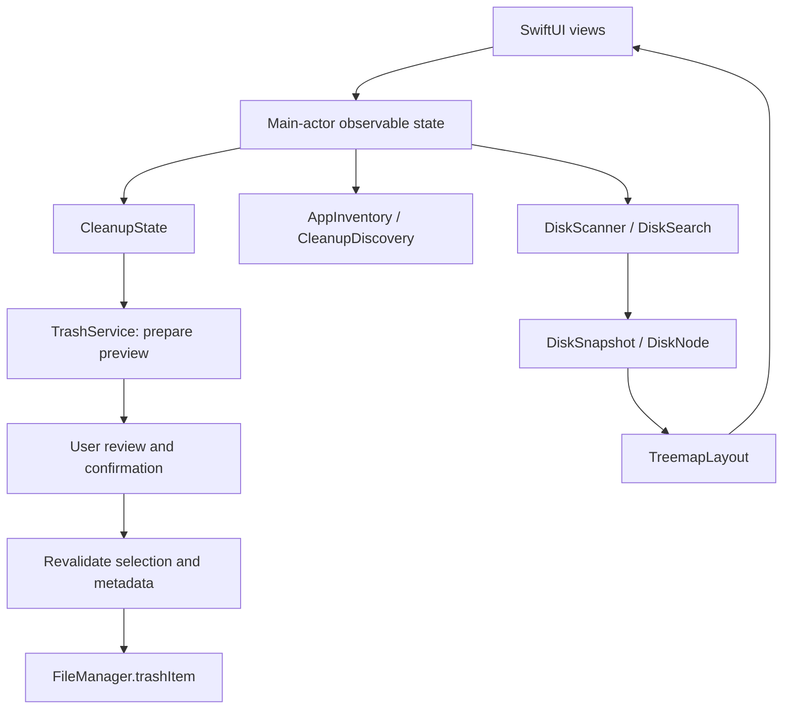

<div align="center">
  
  <h1>Aster</h1>
  <p><strong>A little clarity. A lot of space.</strong></p>
  <p>A native macOS storage explorer with a visual disk map and cleanup you review.</p>
  <p>macOS 14+ · Apple Silicon + Intel · Swift + SwiftUI · MIT licensed</p>
  <p><a href="#build-and-run">Build & run</a> · <a href="docs/BUILD_AND_INSTALL.md">Packaging guide</a> · <a href="docs/ARCHITECTURE.md">Architecture</a> · <a href="docs/CLEANUP_RULES.md">Cleanup rules</a> · <a href="#contact-and-development">Contact</a></p>
</div>



**All implemented features are currently free.** No account, payment, activation key, trial expiry, or first-100-user limit is required. This repository contains source code; it does not currently provide a GitHub release download.

## What Aster does

| Feature | How it works |
| --- | --- |
| Disk and folder scans | Reads real filesystem metadata, with progress, cancellation and explicit partial-scan reporting. |
| Storage map | A proportional, interactive squarified treemap with folders, categories and file inspection. |
| Large-file search | Search paths, filter by category/minimum size, and sort by size, name or modification date. |
| Caches and logs | Measures existing user cache/log folders and supported developer cache locations. |
| Application inventory | Discovers third-party app bundles and matches supported associated data by exact bundle identifier. |
| Possible leftovers | Flags supported bundle-ID data whose app was not found in a complete inventory. These are suggestions to review. |
| Reviewed cleanup | Queue selected items, inspect paths and warnings, then confirm a move to macOS Trash. |
| Native controls | Copy Path, Show in Finder, scan details, keyboard shortcuts, and saved light/dark appearance. |

Aster does not decide that a file is unnecessary merely because it is large, old, or inside a cache. **You choose what can go.** It never automatically empties Trash or falls back to permanent deletion.

## Screenshots

These are captures of the app's actual SwiftUI/AppKit views. They use a real scan of deliberately created documentation sample files, not a user's personal disk. File sizes are logical sizes of sparse fixtures, not a claim about reclaimable space or performance. No sample data is loaded by the shipping app. [Capture notes](docs/SCREENSHOTS.md).

### Light appearance



### Large files



### Cleanup queue



Dark is the default. Change it through **Appearance**, **Aster → Settings…** (`⌘,`), or **View → Appearance**.

## Build and run

Requirements: macOS 14 or later, Xcode/Command Line Tools with a Swift 6-capable toolchain, and Git. The package uses Swift 5 language mode. There are no third-party Swift package dependencies.

Copy this repository’s HTTPS URL from GitHub’s **Code** button and replace `REPOSITORY_URL` below:

```sh
git clone REPOSITORY_URL aster
cd aster
./scripts/build-app.sh
open dist/Aster.app
```

The app scans your home folder on launch. Use **Scan folder** to select another location. Names, sizes and results come from the filesystem; no invented storage totals are used.

Build one local ZIP for both CPU families:

```sh
./scripts/build-app.sh --universal
```

This creates `dist/Aster.app` and `dist/Aster-universal-local.zip`. A universal app contains both `arm64` and `x86_64` slices; separate Intel and Apple Silicon downloads are not required.

**Local builds are ad-hoc signed, not notarized for public distribution.** For toolchain setup, Xcode editing, tests, ZIP packaging, optional DMG creation, and signed website releases, follow the [step-by-step build and installation guide](docs/BUILD_AND_INSTALL.md). The repository contains no personal signing identity, certificate, private key, or notarization credentials.

## Tech stack

| Layer | Technology | Purpose |
| --- | --- | --- |
| Language/build | Swift, Swift Package Manager | Two production modules and two test targets; native macOS executable. |
| Interface | SwiftUI, AppKit, SF Symbols | Views, windows, native folder selection, Finder integration and confirmation UI. |
| State | Observation (`@Observable`, `@Bindable`), `@MainActor` | Observable application and feature state, with UI updates on the main actor. |
| Work scheduling | Swift concurrency, tasks, cancellation, actors | Background scans/searches and serialized cleanup-preview bookkeeping. |
| Filesystem | Foundation `FileManager`, Darwin `lstat` | Enumeration, metadata, no-follow link handling and macOS Trash moves. |
| Change detection | CryptoKit SHA-256 | Metadata fingerprints for revalidation before cleanup; not content deduplication. |
| Map geometry | CoreGraphics, custom squarified treemap | Deterministic weighted rectangles, drawn by SwiftUI. |
| Local preferences | `@AppStorage` / UserDefaults | Saved appearance preference. |
| Optional paid code | URLSession, Codable, Security/Keychain | Dormant Dodo licensing implementation; disabled in the current free build. |
| Tests/distribution | XCTest, Bash, Python 3, Apple command-line tools | Isolated filesystem tests, app bundling, signing and notarization scripts. |

This is a native Mac app. It does not use Electron, a web frontend, a database server, or a required backend.

## Architecture and design patterns

The project uses an **MVVM-style separation of SwiftUI views, observable state and core services**. State types have descriptive names such as `AppState`, `CleanupState` and `InventoryState`; they are not all named `ViewModel`. It is not a strict implementation of Clean Architecture.



Patterns include service separation, dependency injection at system boundaries, value-based result models, deterministic layout/search functions, and a two-stage preview/execute cleanup workflow. [Architecture and code map →](docs/ARCHITECTURE.md)

## How cleanup decisions are made

1. **Discover candidates:** existing cache locations, exact app identifiers, or files explicitly selected by the user.
2. **Explain the evidence:** show the actual path, measured size, matching reason and warnings. “Possible leftover” does not mean “safe to delete.”
3. **Prepare a fresh preview:** collapse overlapping selections, validate paths, recursively measure entries and record a metadata fingerprint.
4. **Ask for confirmation:** review the selected items, then confirm the separate destructive-action dialog.
5. **Recheck and move:** reject stale/changed/blocked items, respect app-data dependencies, and call macOS Trash only for confirmed eligible items.
6. **Report each outcome:** moved, skipped or failed. Canceling stops remaining work; it does not undo completed moves.

See [cleanup rules, developer-cache policy, protections and limitations](docs/CLEANUP_RULES.md) for the exact scope, including Docker and Kubernetes.

## Privacy and practical limits

- Storage scanning reads file metadata. Application identification additionally reads bundle `Info.plist` files. Results stay on the Mac.
- The current free policy makes no Dodo checkout/license requests. The **Contact me** link opens your email client; it does not send a message automatically.
- macOS permission controls still apply. Review **System Settings → Privacy & Security → Full Disk Access** if you choose to grant broader access. Aster cannot override protected locations.
- Scans cap at 250,000 entries and retain up to 100 scan issues. Search displays up to 500 matches while reporting the full match count within the scanned snapshot.
- Symbolic links are not followed. A startup-disk scan excludes `/System/Volumes` and `/Volumes`; scan an external volume directly.
- Logical size, allocated estimates and recoverable space differ because of APFS clones, snapshots, sparse files, compression and other filesystem behavior. Moving files to Trash does not immediately free that space.
- No automatic cleaning, root helper, permanent-delete fallback, Trash emptying, self-updater, malware scanner or content-based duplicate finder is implemented.

## Tests and contributions

```sh
swift test
```

The test targets cover scanning, search, treemap geometry, cache/app discovery, cleanup protections, free access and dormant licensing behavior. Cleanup tests use isolated fixtures and an injected mover; they do not clean the developer's personal files or Trash. For reproducible local cache paths, see the [testing guide](docs/BUILD_AND_INSTALL.md#run-tests).

Before submitting changes, read [CONTRIBUTING.md](CONTRIBUTING.md). Keep generated builds, real-data screenshots and credentials out of Git. Security-sensitive reports should go to the contact email rather than a public issue containing private paths or credentials.

## Contact and development

Maintained by **Aster contributors**. For questions, feedback, development discussions or private security reports, contact **[shivamrohillaa@gmail.com](mailto:shivamrohillaa@gmail.com)**.

## License

Aster's source code and accompanying project documentation are available under the [MIT License](LICENSE). Preserve the copyright and permission notice in copies or substantial portions of the software. Apple SDKs, system symbols and external services remain subject to their own terms.
